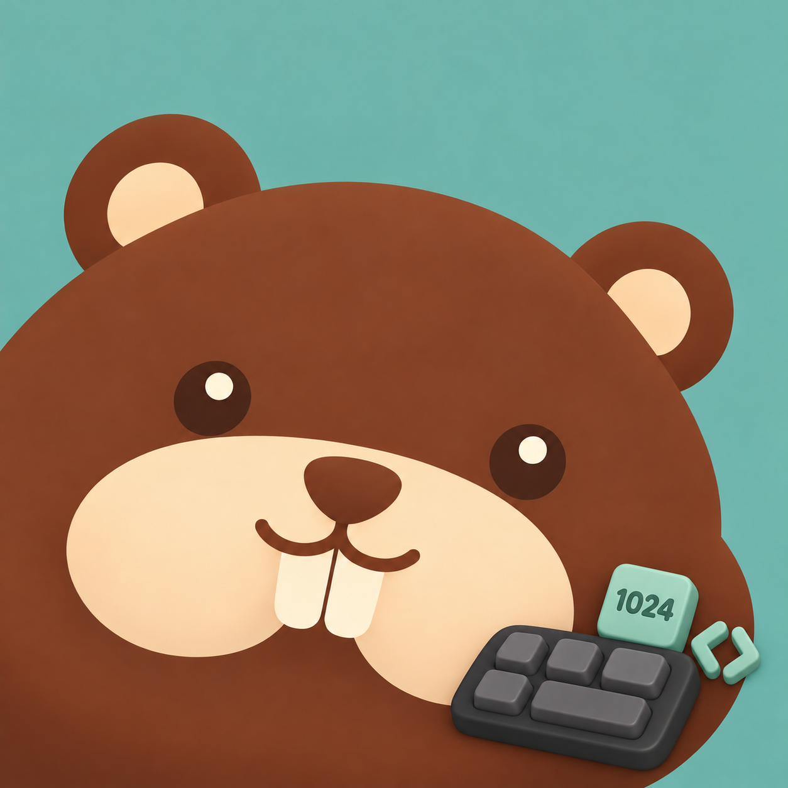

# BeaverMeter · A1-v2 accessory layout refinement

This revision responds to the user's request for more considered accessory
placement. Every outfit is edited directly from the approved
[A1-v2 master](../ip-as-logo-candidates-2026-10-09/A1-v2.png). Its face, expression,
angle, size, lower-left crop and sage-teal background are retained. The classic
image is a byte-identical copy of that master.

## Composition

The face remains the focus. A primary accessory follows the original head angle;
smaller elements are attached to it or grouped at the outer brown perimeter.
New freestanding props are kept inside the frame. The existing cropped head is
not reduced to make room. The layout brief keeps the cream muzzle, eyes and
front teeth clear; generation observations are recorded in the metadata and
validation record below.

| Classic | New Year | Lunar New Year |
| --- | --- | --- |
|  |  |  |

| Lantern Festival | Dragon Boat | Mid-Autumn |
| --- | --- | --- |
|  |  |  |

| Programmers' Day | Halloween | Christmas |
| --- | --- | --- |
|  |  |  |

## Accessory placement

| Variant | Layout brief | Original record |
| --- | --- | --- |
| `standard` | A1-v2 unchanged | [Metadata](beaver-standard.metadata.json) |
| `newYear` | Hat follows the crown; confetti stays near its tip; blower is a smaller side accent | [Metadata](beaver-newYear.metadata.json) |
| `lunarNewYear` | Narrow scarf below the muzzle; envelope and ingot share one foreground cluster | [Metadata](beaver-lunarNewYear.metadata.json) |
| `lanternFestival` | Lantern beside the right ear, bowl below; short loop rather than a frame-edge cord | [Metadata](beaver-lanternFestival.metadata.json) |
| `dragonBoat` | Leaves tuck behind an ear; zongzi and paddle form one group | [Metadata](beaver-dragonBoat.metadata.json) |
| `midAutumn` | Osmanthus joins the crescent; mooncake sits on the outer brown edge | [Metadata](beaver-midAutumn.metadata.json) |
| `programmerDay` | Keyboard, 1024 chip and brackets form one compact group below the muzzle | [Metadata](beaver-programmerDay.metadata.json) |
| `halloween` | Bat stays near the bent hat tip; pumpkin remains secondary | [Metadata](beaver-halloween.metadata.json) |
| `christmas` | Holly attaches to the hat brim; complete candy-cane hook remains inside the frame | [Metadata](beaver-christmas.metadata.json) |

## Generation and integration

The built-in ImageGen tool is used once for each of the eight independent edits.
Its model name is not exposed. All returned originals are preserved unmodified;
all nine source images are 1254 × 1254. Each record includes the exact prompt, sole reference, source path, native
dimensions and hashes. Existing outfit images are not edit references.

[Collection](holiday-collection.png) · [Exact prompts](prompts.json) · [Results](results.json) · [Validation](VALIDATION.md)

Color runtime exports use the full source canvas and one common scale. The menu
bar retains its shared monochrome outline, Finder retains A1-v2, and Widgets
retain provider logos. Layout, settings, variant IDs and automatic dates are
unchanged; Programmers' Day remains October 24.

The previous [direct-edit family](../a1-master-holidays-2026-10-09/README.md) and
[centered-head study](../round-beaver-2026-10-09/README.md) remain archived with
their original outputs and prompts.
