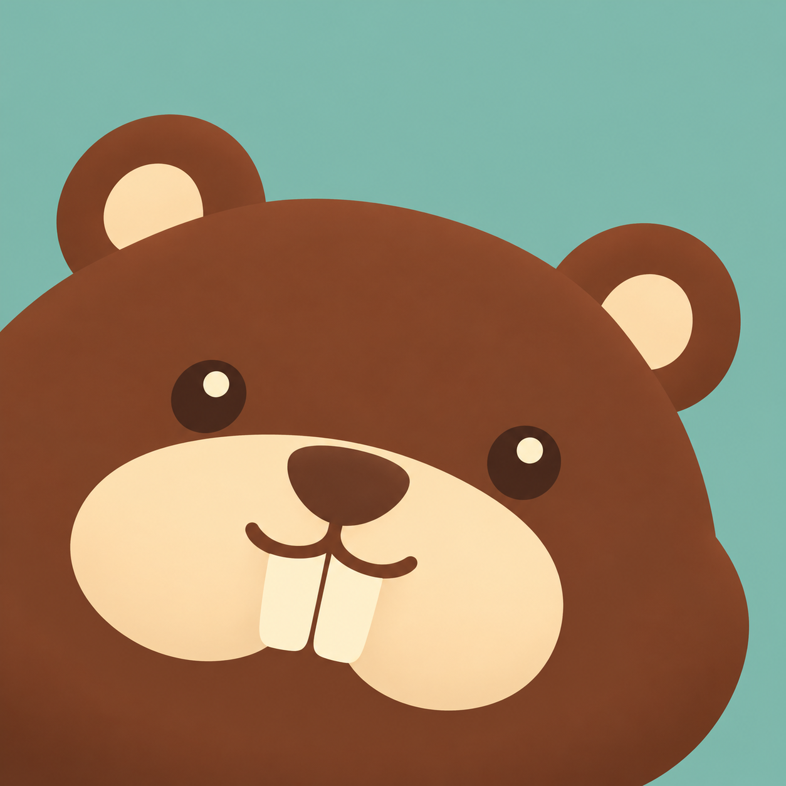
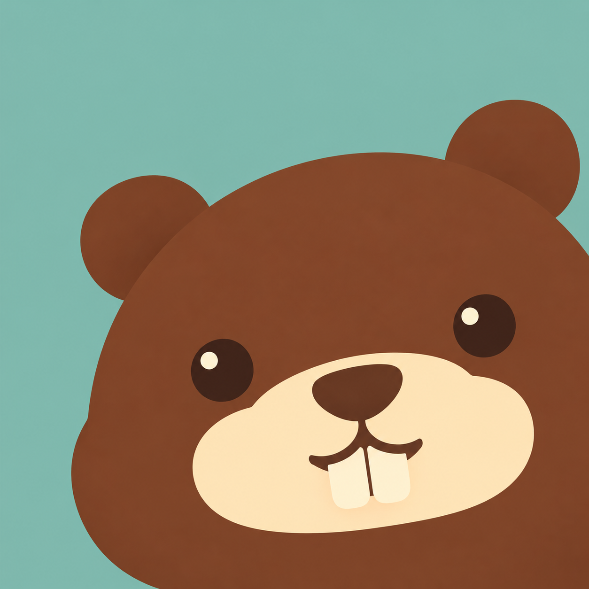
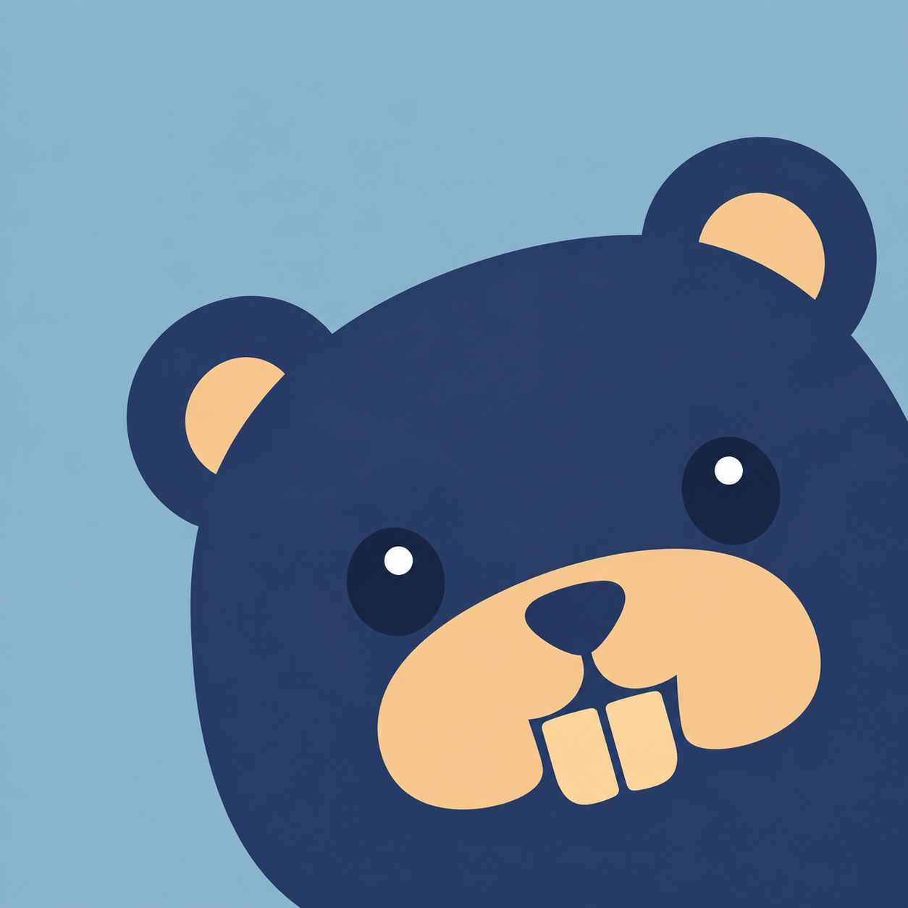
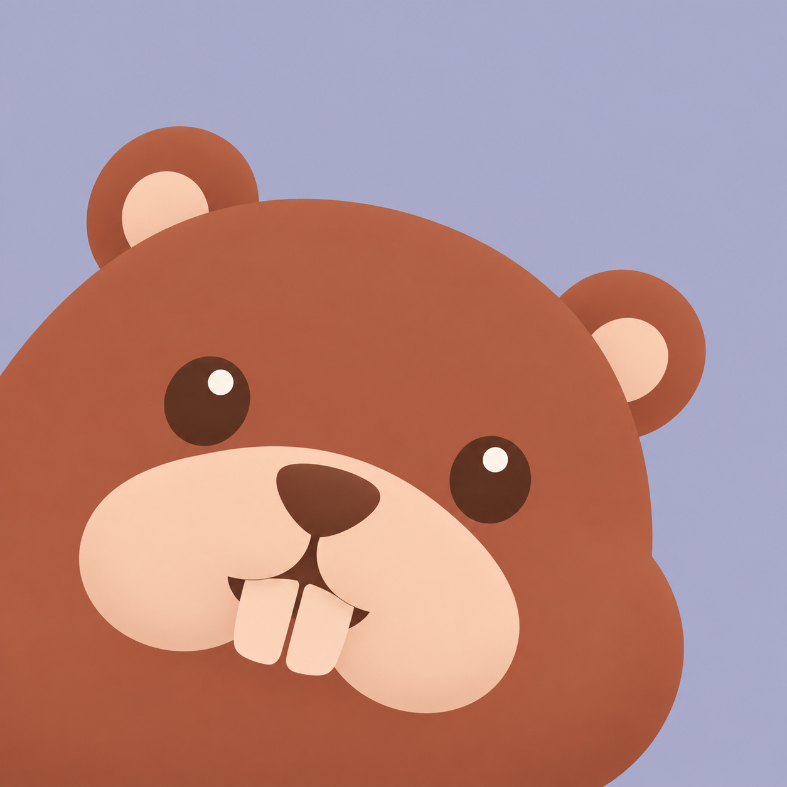
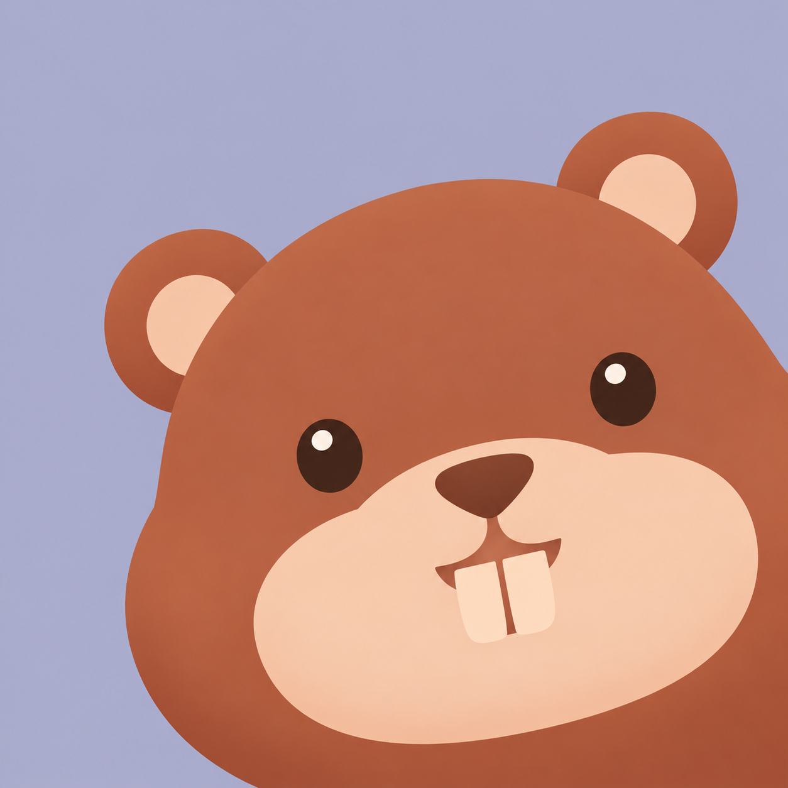

# BeaverMeter · IP as Logo candidates

First-round exploration using [IP as Logo](https://github.com/s1dashu/ip-as-logo-skill/blob/main/SKILL.md), generated with the built-in ImageGen tool. The interface does not expose its model name; the user explicitly approved this tool.

Each candidate is generated independently exactly once, without image references. Every original is retained without edits or resampling. A selected candidate will be adapted into production assets in a separate stage.

All six returned originals are **1254 × 1254** pixels. Their bytes and native dimensions have been recorded; no production artwork has been replaced.

## Candidate overview

| Candidate | Direction | Rationale | Assigned corner | Subject colors | Solid background |
| --- | --- | --- | --- | --- | --- |
| A1 | 奶油圆脸 | 延续 BeaverMeter 温暖亲切的感觉，用宽圆脸和短门牙减少小尺寸细节。 | lower-left | warm chestnut brown #6F3D25 / warm cream #FFE8BE | gently muted sage teal #7EB9AE |
| A2 | 奶油圆脸 | 延续 BeaverMeter 温暖亲切的感觉，用宽圆脸和短门牙减少小尺寸细节。 | lower-right | warm chestnut brown #6F3D25 / warm cream #FFE8BE | gently muted sage teal #7EB9AE |
| B1 | 方圆海狸 | 通过紧凑的圆角方脸与明确门牙，表现稳定、易读的桌面工具性格。 | lower-left | deep indigo #263B65 / warm apricot #F4CB95 | gently muted dusty blue #91B8CD |
| B2 | 方圆海狸 | 通过紧凑的圆角方脸与明确门牙，表现稳定、易读的桌面工具性格。 | lower-right | deep indigo #263B65 / warm apricot #F4CB95 | gently muted dusty blue #91B8CD |
| C1 | 桃色小海狸 | 用梨形脸与小圆耳呈现轻巧、活泼的角色，为后续节日装扮留出简洁轮廓。 | lower-left | warm terracotta #AB523D / light peach #F8D0B8 | gently muted lavender #AEAFCD |
| C2 | 桃色小海狸 | 用梨形脸与小圆耳呈现轻巧、活泼的角色，为后续节日装扮留出简洁轮廓。 | lower-right | warm terracotta #AB523D / light peach #F8D0B8 | gently muted lavender #AEAFCD |

## Preview

| 奶油圆脸 · A1 | 奶油圆脸 · A2 |
| --- | --- |
|  |  |

| 方圆海狸 · B1 | 方圆海狸 · B2 |
| --- | --- |
|  |  |

| 桃色小海狸 · C1 | 桃色小海狸 · C2 |
| --- | --- |
|  |  |

## A1 refinement · A1-v2

根据用户对 A1 的反馈，使用原图进行一次 ImageGen 编辑：脸颊和耳朵更圆润，门牙更短，保留栗棕与奶油色、鼠尾草青背景和左下探头构图。首轮六张原图完整保留；用户已选定 A1-v2，当前[八套节日装扮](../a1-layout-refinement-2026-10-09/README.md)都直接以它为参考，仅添加配饰并保留母版构图。

原始输出：[A1-v2.png](A1-v2.png)。完整编辑提示词与实际尺寸：[A1-v2.metadata.json](A1-v2.metadata.json)。

## Generation records

The exact positive prompts, color mapping, composition assignments and product brief are in [prompts.json](prompts.json). Constraints use a single natural-language line within the main prompt; no dedicated negative-prompt parameter is used. The target is approximately 1536 × 1536; native 1254 × 1254 output is accepted and preserved.

Each `<label>.metadata.json` records the returned source path and actual native dimensions. [results.json](results.json) aggregates the final records. These records identify the tool/provider only to the extent exposed by the runtime; they do not infer a model name.

## Production after selection

The user selects the master from A1–C2 before production generation:

- Finder AppIcon retains the selected solid background and corner-emergence composition.
- Popover assets use A1-v2 itself and eight direct accessory edits, keeping its original pose and background.
- All nine menu templates share one monochrome outline drawn from the selected character.
- Existing frosted-glass UI, variant IDs, appearance settings and holiday rules remain intact; Programmers' Day stays October 24.
- Widgets continue to use official provider logos.

No production resource is replaced during this candidate stage.
