<p align="center">
  
</p>

<h1 align="center">BeaverMeter</h1>

<p align="center"><b>What you’ve used. What you have left.</b><br>
Codex, Claude Code, Cursor and DeepSeek usage in your Mac’s menu bar and desktop Widgets.</p>

<p align="center">
  <a href="https://www.apple.com/macos/"></a>
  <a href="CHANGELOG.md"></a>
  <a href="LICENSE"></a>
</p>

<p align="center"><b>English</b> · <a href="README.zh-CN.md">简体中文</a></p>

<p align="center">
  <a href="#install--update">Install</a> ·
  <a href="#the-menu-bar">Menu</a> ·
  <a href="#desktop-widgets">Widgets</a> ·
  <a href="#data--privacy">Data &amp; privacy</a> ·
  <a href="#help--development">Help</a>
</p>

<p align="center">
  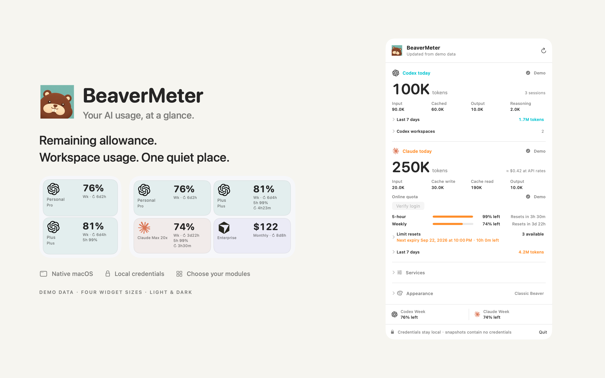
</p>

## Install & update

BeaverMeter requires **macOS 14 or later**. To build and install from source,
follow the [source installation guide](docs/guide/development.md#build-and-install).
CodexBar does not need to be installed or running.

If you have a Universal DMG package, it supports Apple Silicon and Intel and
needs no Xcode or Homebrew to install:

1. Open the DMG and drag **BeaverMeter** to **Applications**.
2. Eject the disk image, then open the installed app.
3. Add **BeaverMeter** from your desktop’s **Edit Widgets** menu.

First launch registers the Widget and sets up background refresh. Existing
settings, sign-ins and outfits are preserved. `~/Applications` is supported;
when both supported folders contain an official copy, `/Applications` wins.

### Updates

Official builds check once after startup, then every **12 hours**, respecting
the automatic-check preference. A newer version adds a small menu-bar dot and
an **Update 1.0.1** button in the popover (example version).

Click it for Sparkle’s native release-notes, download, verification and
**Install and Relaunch** flow. **Check for Updates…** checks manually.
Background checks do not open an update window or install automatically.
Account sign-in must finish before an update can be installed.

Current packages are ad-hoc signed and **not Apple notarized**; if macOS
blocks first launch, follow [Apple’s instructions](https://support.apple.com/en-us/102445).

See [setup and updates](docs/guide/setup.md) for update availability,
service connection and recovery details.

## The menu bar

Click the beaver to open the popover. Launching or reopening the app also opens
it; Escape or a click outside closes it. A desktop Widget opens the same menu.
The menu bar keeps a compact beaver mark; the tooltip and VoiceOver retain usage
details. The interface uses English labels and follows the system appearance.

| Service | Menu information |
| --- | --- |
| Codex | Recorded tokens, allowance windows, reset credits and separate workspaces |
| Claude Code | Recorded tokens, estimated API list-price cost, quota windows and limit resets |
| Cursor | Actual call charges, today’s charge, recent calls and monthly allowance |
| DeepSeek | Wallet balance, current-month cost, tokens and requests |

<p align="center">
  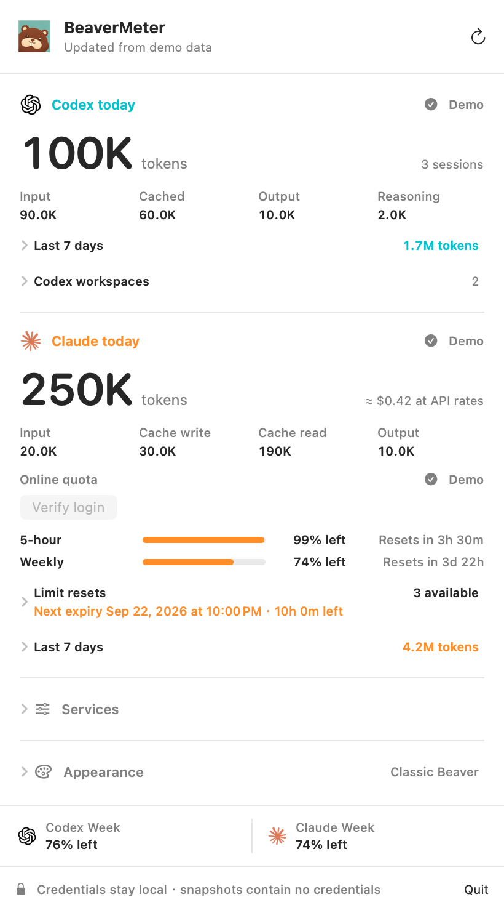
  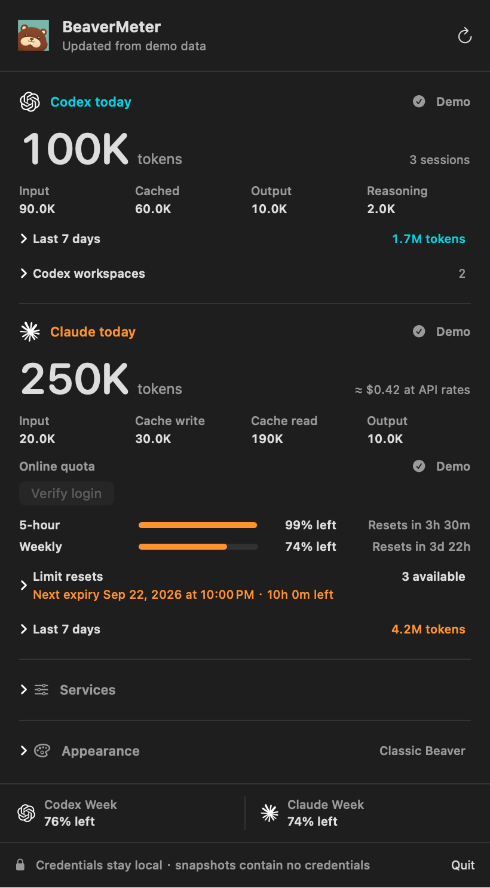
</p>

Expand history, workspaces or settings when needed. Foldout states are remembered.
**Services** chooses which providers are available; automatic detection is the
default. Disabled services are not collected.

### Workspaces and connections

- **Codex:** expand **Codex workspaces → Add workspace…**, give it a name and finish browser sign-in. Each login is stored separately. Existing profile homes can also be configured.
- **Claude:** use **Online quota → Sign in to Claude…**, or **Verify login** after signing in through Claude Code. Local transcript totals remain independent of online quota.
- **Cursor:** sign in to the intended account in Cursor, then refresh BeaverMeter. If Keychain access is needed, choose **Allow Cursor access…** and approve the macOS dialog once. A verified session supports silent refresh; sign-in changes require verification again.
- **DeepSeek:** choose **Connect in browser…** and finish signing in on the official Platform page.

Workspaces sharing an email keep their own plans, quotas and activity. A missing
or mismatched workspace never borrows another workspace’s reading.
[Setup](docs/guide/setup.md) explains CLI requirements, profile configuration,
Keychain access and browser permissions.

### Make the beaver yours

Choose **Appearance → Logo** for Classic Beaver or a seasonal edition.
**Automatic · Local Calendar** follows the Mac’s date and time zone, including
Chinese-calendar holidays. Calendar access is unnecessary.

The original artwork and seasonal designs are preserved in the
[brand collection](Design/Logo/README.md); [setup](docs/guide/setup.md#appearance)
explains automatic dates and local preferences.

## Desktop Widgets

Choose and order modules independently for each Widget in **Edit Widget**.
A **module** is one service or one Codex workspace, with its available principal
allowance windows. Source workspaces do not expand into extra modules.

Connect services in the menu first. Editing Widget modules does not change
sign-ins or service switches.

| Size | Slots used | Information and layout |
| --- | ---: | --- |
| Small | First 2 | Identity, both remaining values and the main reset; one main card or two compact cards |
| Medium | First 4 | Both window reset details; up to three columns or four modules in 2×2 |
| Large | First 6 | Usage inside each module; two–four full-width rows, five–six modules in two columns |
| Extra Large | First 6 | Usage; exactly four visible modules use 2×2 without seven-day statistics/trends; other counts retain available trends, with five–six in three columns |

Empty, duplicate, invalid or hidden choices do not pull later slots forward.
Defaults put one module from each enabled service first. There is no `+N` badge.
Removed selected workspaces remain unavailable until you change the selection.

Each identity stacks its **logo → workspace name, when present → known plan**.
Ordinary service names are not repeated; full names remain in help and VoiceOver.
Unknown plans are omitted, and a spending limit never supplies a plan name.

### Day and night previews

<table>
  <tr><th>Size</th><th>Day / light</th><th>Night / dark</th></tr>
  <tr>
    <th>Small<br>2 modules</th>
    <td align="center"><a href="screenshots/widget-small-light.png">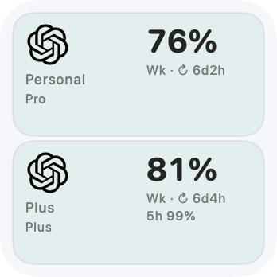</a></td>
    <td align="center"><a href="screenshots/widget-small.png">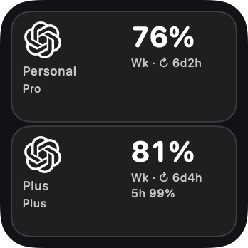</a></td>
  </tr>
  <tr>
    <th>Medium<br>4 modules</th>
    <td align="center"><a href="screenshots/widget-medium-light.png">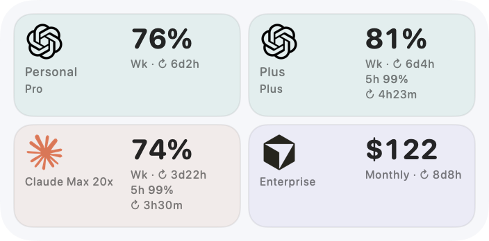</a></td>
    <td align="center"><a href="screenshots/widget-medium.png">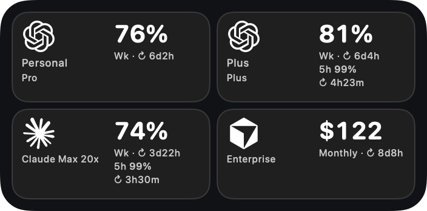</a></td>
  </tr>
  <tr>
    <th>Large<br>4 modules</th>
    <td align="center"><a href="screenshots/widget-large-light.png">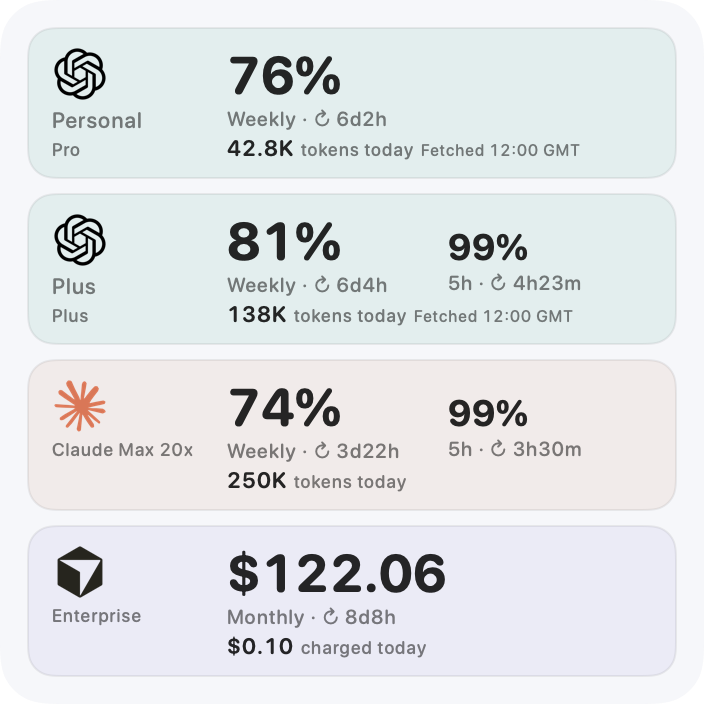</a></td>
    <td align="center"><a href="screenshots/widget-large.png">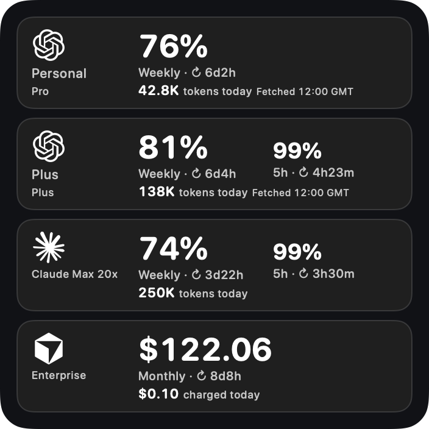</a></td>
  </tr>
  <tr>
    <th>Extra Large<br>4 modules</th>
    <td align="center"><a href="screenshots/widget-extra-large-light.png">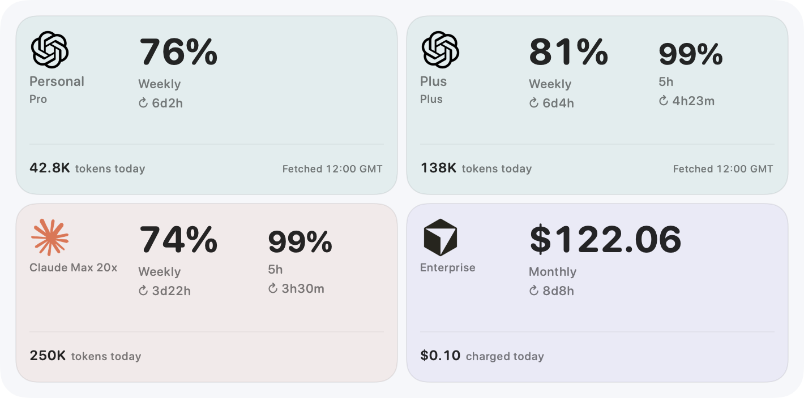</a></td>
    <td align="center"><a href="screenshots/widget-extra-large.png">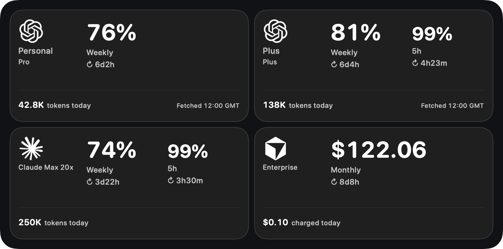</a></td>
  </tr>
</table>

All previews use the same ordered synthetic Personal, Plus, Claude and Cursor
selection. Small shows only the first two modules. Click an image for its original size.

### What stays with the module

Both principal allowance values and the main reset remain visible. Small omits
the secondary reset; larger sizes show both window details. Claude leads with
the all-model weekly allowance when available. Cursor shows remaining monthly
allowance, and DeepSeek shows its primary wallet balance and currency.

Large and Extra Large add activity inside the corresponding identity:
Codex workspace rows show **tokens today**, Claude its recorded tokens,
Cursor today’s actual charge and DeepSeek current-month tokens or calls.
Extra Large omits seven-day statistics/trends when exactly four modules are
visible in 2×2, with paired quotas above a fixed current-usage footer. Other module
counts still show available history. Known zero remains zero; missing days remain empty. Quota,
activity and history have separate status.

Codex workspace activity uses its verified account ledger. Original service
bucket/report dates stay in help and accessibility details. **`Fetched HH:mm <zone>`**
is the query time, separate from response generation and the source’s report
date; cached readings keep the original clocks. A visible label does not change
the source period or establish a complete real-time account total.

Reset-card inventory/expiry, Cursor used/limit, token categories and individual
calls stay in the menu. Light/dark and reduced-color rendering follow WidgetKit;
normal rows omit redundant checkmarks. See [data details](docs/guide/data.md)
and [six-module examples](docs/guide/setup.md#widget-selection).

## Data & privacy

- Provider-wide Codex/Claude activity comes from local logs; optional SSH adds configured remote Codex records. Separate Codex workspace activity uses the account API.
- Credentials stay local. Usage snapshots contain no authentication tokens, cookies, prompts or response content.
- Verified Cursor sessions are saved in a private, owner-only `cursor-session.json` on this Mac. Cursor's Keychain encryption key is never saved.
- Workspaces retain separate identity and cache scope. Authentication or identity mismatch clears affected protected readings.
- Temporary failures can retain a clearly marked stale value within that source’s limit. Unknown is not zero; preview data never fills missing live data.
- Disabled services are not contacted. Optional SSH goes only to the configured host; update requests use GitHub Release assets without provider credentials.
- DeepSeek’s validated browser token is stored privately for background refresh. Sparkle does not enable system profiling.

Local service polls normally run every 45 seconds while the app is running;
full background collection defaults to five minutes. A contended fast poll is
coalesced rather than queued behind a full refresh. WidgetKit controls final
Widget timeline scheduling.

Read [data sources and storage](docs/guide/data.md) for token arithmetic, ledger
periods, browser/Keychain behavior, cache limits and file paths.

## Help & development

Start with the guide that matches the task:

- [Setup and updates](docs/guide/setup.md) — install, connect services, configure workspaces and choose modules.
- [Data and privacy](docs/guide/data.md) — sources, counting, timestamps, caches and storage.
- [Troubleshooting](docs/guide/troubleshooting.md) — sign-in, missing/stale data, Widgets and update recovery.
- [Development](docs/guide/development.md) — source install, tests, synthetic previews and packaging.

For contributors, the main local check is:

```sh
./scripts/test.sh
```

The implementation uses SwiftUI, WidgetKit and an independent collector.
[Synthetic performance measurements](docs/PERFORMANCE.md) and
[actual runtime observations](docs/RUNTIME_PERFORMANCE.md) are recorded separately;
no frame-rate or “all stutter resolved” claim is made.

See the [changelog](CHANGELOG.md), [release policy](docs/RELEASE_POLICY.md)
and [validation record](docs/RELEASE_VALIDATION.md).

BeaverMeter is [MIT licensed](LICENSE). CodexBarCore, Sparkle, artwork and provider
logo sources are recorded in [third-party notices](THIRD_PARTY_NOTICES.md) and
[provider sources](Design/ProviderSources/README.md).
