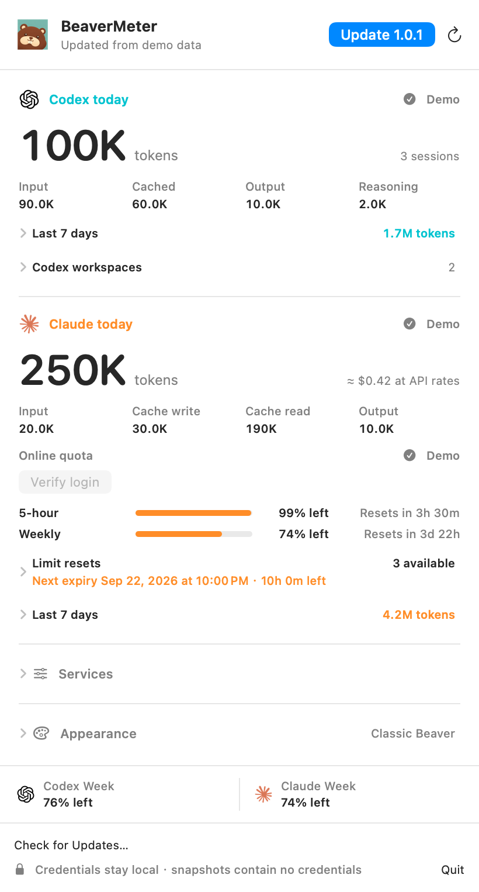
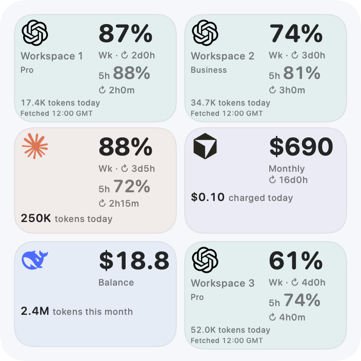
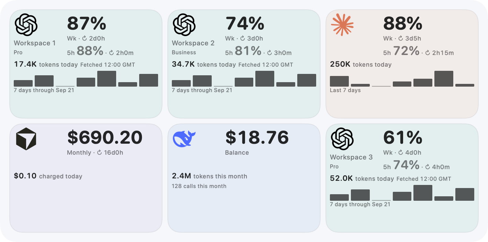

# Setup and updates

[简体中文](setup.zh-CN.md) · [README](../../README.md)

## Installation

BeaverMeter requires macOS 14+. Follow [source installation](development.md#build-and-install)
to build this checkout. CodexBar does not need to be installed or running.

If you have a Universal DMG package, it supports Apple Silicon and Intel without
requiring Xcode, XcodeGen or Homebrew to install:

1. Open the DMG and drag BeaverMeter to `/Applications` or `~/Applications`.
2. Eject the image and open the installed app.
3. Add BeaverMeter from **Edit Widgets** on the desktop.

If both supported directories contain an official app, `/Applications` takes
precedence. Downloads, mounted images and App Translocation are not runtime
installation locations. A duplicate copy is not silently deleted.

Current apps are ad-hoc signed, not Apple notarized. Follow
[Apple’s first-launch guidance](https://support.apple.com/en-us/102445) if macOS
blocks a trusted package. BeaverMeter does not disable Gatekeeper or remove
quarantine attributes. An unwritable installation folder may need administrator
authorization.

First launch registers the Widget and configures per-user background refresh.
Existing settings, sign-ins and appearance preferences are preserved.
[Release policy](../RELEASE_POLICY.md) describes lifecycle and rollback behavior.

## Updates

Official builds start Sparkle once and perform one background startup check when
automatic checks are enabled. Sparkle then checks on its default **12-hour**
schedule, respecting its automatic-check preference.

When a newer verified version is available:

- The menu-bar beaver has a small notification dot.
- The popover offers **Update 1.0.1** (example version).
- Clicking it opens Sparkle’s native notes/download/verification interface.
- Choose **Install and Relaunch** to apply it. **Check for Updates…** checks manually.

Automatic checks do not open an update window or install automatically. Active
account sign-in must finish before installation. Runtime preparation briefly
pauses this app’s collection; relaunch restores registration and refresh.
If installation is cancelled or fails, the existing app and its runtime can
recover. Reopen BeaverMeter if the new app did not relaunch.

Source/local/preview builds do not use the production updater. The update feed
and assets use GitHub HTTPS without provider credentials; Sparkle system profiling
is disabled. A synthetic update screenshot is not a release announcement.

<picture><source media="(prefers-color-scheme: dark)" srcset="../../screenshots/menu-update-dark.png"></picture>

## Services

Open the beaver menu and expand **Services**. Automatic detection is the default;
explicitly disabled providers are not collected. Service availability is shared
by the menu, Widget choices and collector. Choosing a Widget module does not
sign in to a service or enable a disabled provider.

### Codex workspaces

Expand **Codex workspaces → Add workspace…**, name the workspace and complete
Codex browser sign-in. A usable Codex CLI must be available; CodexBar itself is
not required. BeaverMeter keeps each managed login under its own
`codex-workspaces/<UUID>` directory in Application Support. **Sign in…** reconnects
a workspace, and failed sign-in can be retried from the menu.

To reuse existing profile homes, choose **Open configuration…** and edit
`~/Library/Application Support/BeaverMeter/beaver-meter-accounts.json`:

```json
{
  "version": 1,
  "providers": [{
    "id": "codex",
    "codexProfileHomePaths": ["~/.codex-work", "~/.codex-personal"]
  }]
}
```

Each home needs its own valid Codex sign-in. The current `CODEX_HOME` or default
`~/.codex` is included; duplicate/symlink-equivalent homes are read once. Refresh
after saving. BeaverMeter reads its own workspace registry and explicitly
configured homes, not CodexBar’s managed-login collection.

An explicit quota workspace selection can be added beside `version/providers`:

```json
"codexWorkspaces": [
  {"home": "~/.codex-work", "workspaceAccountID": "<ChatGPT workspace UUID>", "workspaceLabel": "Research"}
]
```

Use a ChatGPT workspace ID, not an API organization ID (`org-…`). Quota identity
must be validated by the applicable response. Workspace token ledgers are
stricter: the selected workspace must match the native credential/access-token
account, and the ID-token account when present. A header override does not make
a ledger valid. Use a separately signed-in native profile for that workspace.
External auth files are not rewritten to switch accounts. See [data](data.md).

### Claude Code

Local tokens require Claude Code transcripts. Online quota uses Claude Code’s
saved sign-in and is independent of transcript availability.

- **Sign in to Claude…** starts explicit browser authorization.
- **Verify login** checks an existing login against the current quota service.
- **Allow Claude access…** can request macOS access to an existing Keychain credential.
- **Cancel** stops the current authentication operation.

A Keychain access problem does not automatically mean sign-out. Scheduled reads
are noninteractive. **Repair Keychain session…** is a separately confirmed
lock/unlock workaround for a stale login-Keychain session; macOS asks for the
Mac password. Cancelling unlock can leave that Keychain locked. The operation
does not delete credentials or modify access lists.

For a non-default profile set `CLAUDE_CONFIG_DIR` in the private `config.env`.
[Data](data.md#claude-code) and [troubleshooting](troubleshooting.md) explain
renewal, secure-storage selection and retry limits.

### Cursor

Sign in to the intended account in Cursor, then refresh BeaverMeter. The
collector reuses Cursor’s local sign-in. It reports actual dashboard charges,
not model list prices; team pools are not individual monthly allowances.

### DeepSeek

Choose **Connect in browser…**, finish signing in on the official Platform page,
then use **Check now** if necessary. Closing the popover does not cancel the
background connection attempt.

Chromium-family browsers supply only the official site’s `userToken` entry.
Safari needs Automation access to that tab and these Safari settings:

1. **Settings → Advanced → Show features for web developers**.
2. **Settings → Developer → Allow JavaScript from Apple Events**.

The imported token is validated and saved privately for background refresh.
[Data](data.md#deepseek) lists its storage and request scope.

## Widget selection

Edit each Widget independently. One module is one service or one Codex workspace
with its principal allowance windows. Limits are **Small 2 / Medium 4 / Large 6 /
Extra Large 6**. Slots are truncated before empty/duplicate/invalid/hidden entries
are filtered; later entries do not backfill them. Default ordering takes one
module per available service first, then additional workspace choices.

Choose a workspace explicitly to keep its quota, plan and activity together.
Removed selections stay unavailable until edited. There is no automatic sibling
expansion or `+N`. Known plans use metadata; unknown plans are omitted.

Small keeps both remaining values and the main reset. Medium adds reset details;
Large adds per-module usage. Extra Large omits seven-day statistics/trends when
exactly four modules are visible in 2×2, keeping quota/current usage; other counts
retain available history. Inventory,
expiration, Cursor used/limit and token categories remain in the menu.

Six-module synthetic boundary examples:

<picture><source media="(prefers-color-scheme: dark)" srcset="../../screenshots/widget-large-six-modules.png"></picture>

<picture><source media="(prefers-color-scheme: dark)" srcset="../../screenshots/widget-extra-large-six-modules.png"></picture>

These are design previews, not evidence that every live theme, focus state or
selection has passed native acceptance. See [preview notes](../WORKSPACE_PREVIEWS.md).

## Appearance

Choose **Appearance → Logo** for Classic Beaver or a fixed seasonal edition.
**Automatic · Local Calendar** uses these dates:

| Outfit | Automatic dates |
| --- | --- |
| New Year | January 1 |
| Lunar New Year | Lunar New Year’s Eve through first-month day 7 |
| Lantern Festival | First lunar month, day 15 |
| Dragon Boat | Fifth lunar month, day 5 |
| Mid-Autumn | Eighth lunar month, day 15 |
| Programmers’ Day | October 24 |
| Halloween | October 31 |
| Christmas | December 24–26 |

Dates use the Mac’s current time zone. Lunar dates use the Chinese calendar and
skip leap months. Other days use Classic Beaver. Startup, local midnight, wake
and clock/time-zone changes trigger a local check, with no calendar permission
or network request. Appearance preferences are stored separately from usage.

Original artwork, seasonal masters and provider sources remain in
[Design/Logo](../../Design/Logo/README.md) and
[Design/ProviderSources](../../Design/ProviderSources/README.md).
